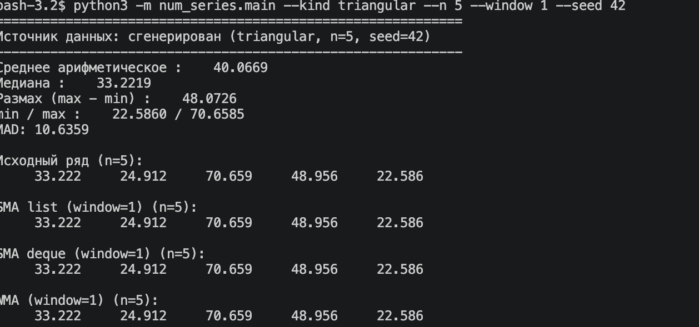
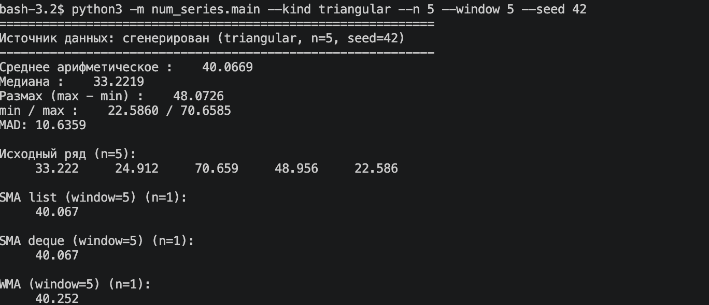

# Лабораторная работа 5.1 — вариант 14

Программа создаёт числовой ряд по формуле:
uniform(0, 50) + uniform(0, 50).

По умолчанию длина ряда — 1000, размер окна — 10.
Длину ряда, размер окна и seed можно задать при запуске.

## Возможности

- Расчёт среднего, медианы, размаха, минимума и максимума.
- Расчёт MAD — медианы абсолютных отклонений от медианы.
- SMA через список и через deque.
- WMA с линейными весами.
- Сравнение времени выполнения двух реализаций SMA.

## Основной запуск

Команды выполняются из главной папки проекта.

```bash
python3 -m num_series.main --kind triangular --n 1000 --window 10 --seed 42 --benchmark
```

## Проверка окна 1

```bash
python3 -m num_series.main --kind triangular --n 5 --window 1 --seed 42
```

Обе SMA и WMA при окне 1 должны совпадать с исходным рядом
с учётом погрешности вычислений.



## Проверка окна, равного длине ряда

```bash
python3 -m num_series.main --kind triangular --n 5 --window 5 --seed 42
```

Обе SMA содержат одно число — среднее всего ряда: 40.067.
WMA содержит одно взвешенное среднее: 40.252.
MAD исходного ряда: 10.6359.

